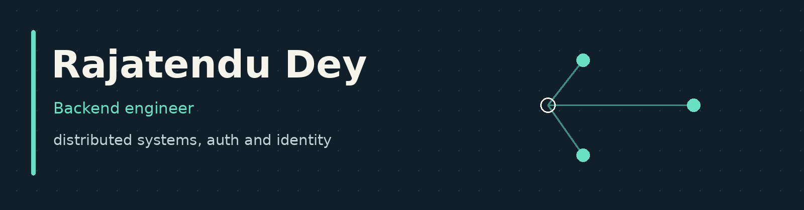

Backend engineer with 4+ years building distributed backend systems, authentication and identity infrastructure, and AI-powered applications. Formerly SDE II at AWS (UnifiedAuth); previously HSBC and HighRadius.

## Current projects

### llmgate
**An OpenAI-compatible LLM gateway**

Routing, failover, streaming, per-key rate limits and usage metering behind one `/v1/chat/completions` endpoint.

| Unit, API and integration tests | End-to-end shell checks | JavaScript smoke gate |
| :---: | :---: | :---: |
| **162** | **61** | **23** |

**[Live demo →](https://llmgate-demo.vercel.app)** - mint a 24-hour key and call it from your own OpenAI-compatible client. Keys reach the simulated providers only; two real free-tier Groq models sit behind explicit buttons.

---

### actas
**Delegation tokens for AI agents**

A reference implementation of RFC 8693 token exchange, where permissions can only shrink down a delegation chain, with DPoP-style sender constraints and a hash-chained audit log.

| Verified checks | Passed |
| :--- | ---: |
| Unit and integration tests | **220** |
| End-to-end HTTP checks | **47** |
| Restart-durability checks | **11** |
| Two-process revocation checks | **6** |

**[Live demo →](https://actas-rajatendu.vercel.app)** - includes a policy workbench for what-if policy review.

---

Both are tested working prototypes, not production services. Source is kept private.

**[Full evidence notes →](https://files.instinct.com/2b6sxnm5u1fv-rajatendu-dey-engineering-portfolio)**

## How these were built

Both projects were designed and built by Instinct, my AI assistant, working at my direction.

## Contact

Open to backend, platform and AI-infrastructure roles, Bangalore or remote.

**[Portfolio →](https://rajatendu-dey.vercel.app)**
