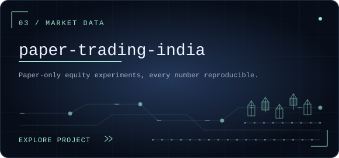

  
  
  
  

  <a href="#projects-tested-and-live">Projects</a> ·
  <a href="#open-source-merged-upstream">Open source</a> ·
  <a href="#evidence-with-receipts">Evidence</a> ·
  <a href="#stack">Stack</a> ·
  <a href="#contact">Contact</a>

Backend engineer building distributed backend systems, authentication and identity infrastructure, and AI-powered applications. Formerly SDE II at AWS (UnifiedAuth) and an engineer at HSBC; previously a machine learning intern at HighRadius.

<table>
<tr>
<td width="50%"></td>
<td width="50%"></td>
</tr>
<tr>
<td width="50%"></td>
<td width="50%"></td>
</tr>
</table>

**llmgate** - routing, failover, streaming, per-key rate limits and usage metering behind one `/v1/chat/completions` endpoint. **[Live demo →](https://llmgate-demo.vercel.app)** · **[Source →](https://github.com/Rajatendu1/llmgate)**

**actas** - an RFC 8693 token-exchange reference implementation where permissions can only shrink down a delegation chain, with DPoP-style sender constraints and a hash-chained audit log. **[Live demo →](https://actas-rajatendu.vercel.app)** · **[Source →](https://github.com/Rajatendu1/actas)**

**paper-trading-india** - a paper-only experiment tracker for Indian equities: a three-year historical simulation with an itemized cost model, logged decisions, and a 449-check script that reproduces every published number. Not investment advice. **[Source →](https://github.com/Rajatendu1/paper-trading-india)**

Both live demos are tested working prototypes, not production services. llmgate keys reach the simulated providers only; two real free-tier Groq models sit behind explicit buttons.

Merged upstream:

- **[gorakhargosh/watchdog #1458](https://github.com/gorakhargosh/watchdog/pull/1458)** - strengthened the `EventDebouncer` tests in watchdog: the old starvation test also passed with elapsed-time flushing removed, so the rewritten tests synchronize the debouncer lifecycle and add regressions that fail under that mutation. Test-only, no production code changed. Merged 14 Nov 2026.
- **[nushell/reedline #1303](https://github.com/nushell/reedline/pull/1303)** - fixed fallback completion highlighting: the fallback searched a lowercased copy and returned UTF-8 byte offsets where the styler expects grapheme indices, so underlining drifted after accents, emoji and case expansions; offsets now map back to the original displayed graphemes. Public API unchanged; 18 added cases with the library suite and doctests passing locally. Merged 14 Nov 2026.
- **[sqlfluff/sqlfluff #9140](https://github.com/sqlfluff/sqlfluff/pull/9140)** - added PostgreSQL `CREATE TRANSFORM` and `DROP TRANSFORM` parsing to SQLFluff: scripts that define procedural-language type conversions (like the `hstore_plpython` extension) now lint without parse errors. Fixtures cover both conversion directions, optional signatures, schema-qualified and quoted names, `IF EXISTS` and `CASCADE`/`RESTRICT`, validated against native PostgreSQL 18 grammar via pglast. Merged 15 Nov 2026.
- **[pyenv/pyenv #3633](https://github.com/pyenv/pyenv/pull/3633)** - fixed python-build's custom dependency header detection: `configured_with_package_dir` only inspected global `CPPFLAGS` alongside a `CPPFLAGS=` configure argument, missed package-specific flags, and read the make-option array instead of the configure-option array, so a custom Readline header path could be ignored and Homebrew's paths prepended ahead of the user's. Now global and package-specific `CPPFLAGS` are checked independently against the configure options. Merged 15 Nov 2026.
- **[jgrapht/jgrapht #1417](https://github.com/jgrapht/jgrapht/pull/1417)** - replaced the recursive biconnectivity DFS with explicit heap frames: deep graphs that overflowed the Java call stack now traverse in the same O(V + E) time with the public API and lazy computation unchanged. Tests include 10,000-vertex paths and cycles that fail with `StackOverflowError` before the fix under `-Xss1m`, and all 1,024 simple graphs on five vertices checked against independent oracles. Merged 17 Nov 2026.

Open work continues upstream across Python, Rust, JavaScript and TypeScript projects; highlights stay capped at the five most recent merged contributions and earlier entries remain in GitHub history.

## Bug reports and investigations

Reported upstream, separate from the merged contributions above. All four reports were open and unassigned when checked on 17 Nov 2026. These are local reproductions, not observed Microsoft Graph or Google Cloud incidents, and not maintainer-confirmed fixes.

- **[microsoft/kiota-python #900](https://github.com/microsoft/kiota-python/issues/900) - Redirect errors that exhaust a connection pool.** Streaming responses left open on redirect-limit or request-construction errors blocked a later request in a one-connection localhost test. Nine regression/control cases: six fail before cleanup, all nine pass with the local candidate. Local candidate only; no PR submitted.
- **[microsoft/kiota-python #901](https://github.com/microsoft/kiota-python/issues/901) - Detached models restored into a backing store.** Stale nested-model subscriptions can restore replaced or cleared values; replacement edits can go untracked. This is a backing-store API reproduction, not demonstrated HTTP PATCH corruption. 18 focused cases: 16 fail on baseline, all 18 pass with the local candidate; 282 package tests pass. Local candidate only; no PR submitted.
- **[googleapis/google-cloud-python #19103](https://github.com/googleapis/google-cloud-python/issues/19103) - Non-blocking refresh after credential serialization.** A pickle roundtrip leaves OAuth2 credentials without the worker expected by non-blocking refresh, causing missing-worker exceptions for stale or expired tokens. Nine mocked local cases: four failures and five passing controls; no real token or network request. Reproduction only; no fix implementation or PR.
- **[googleapis/google-cloud-python #19104](https://github.com/googleapis/google-cloud-python/issues/19104) - Async retry drops a recovery yield.** AsyncStreamingRetry discards a value yielded while handling athrow(), skipping recovery output and disrupting the following send. Eight local cases: three failures and five passing controls on Python 3.10 and 3.13; no Cloud requests. Reproduction only; no fix implementation or PR.

Investigation, candidate patches and reproduction tests developed with Instinct, my AI assistant, at my direction. Each report discloses AI assistance.

| Project | Verified | Checks |
| --- | --- | --- |
| llmgate | 11 Nov 2026 | **274** pytest cases, **61** local end-to-end HTTP checks, a JavaScript smoke gate, plus Docker image and Compose smoke checks in CI |
| actas | 11 Nov 2026 | **48** pytest cases, **17** integration checks, **26** process checks, plus desktop and mobile browser workflows (new post-recovery checks; the original development suite was not recovered) |
| paper-trading-india | 14 Nov 2026 | **31** pytest cases plus a **449**-check independent reproduction of every published EXP-001 number, all passing |

**[Full evidence notes →](https://files.instinct.com/2b6sxnm5u1fv-rajatendu-dey-engineering-portfolio)**

## Stack

  

## GitHub

  

## How these were built

The projects and patches above were designed and built by Instinct, my AI assistant, working at my direction.

## Contact

Open to backend, platform and AI-infrastructure roles, Bangalore or remote.

**[Portfolio →](https://rajatendu-dey.vercel.app)**
