  
  
  
  

  <a href="#projects-tested-and-live">Projects</a> ·
  <a href="#open-source-merged-upstream">Open source</a> ·
  <a href="#evidence-with-receipts">Evidence</a> ·
  <a href="#stack">Stack</a> ·
  <a href="#contact">Contact</a>

Backend engineer building distributed backend systems, authentication and identity infrastructure, and AI-powered applications. Formerly SDE II at AWS (UnifiedAuth) and an engineer at HSBC; previously a machine learning intern at HighRadius.

<table>
<tr>
<td width="50%"></td>
<td width="50%"></td>
</tr>
<tr>
<td width="50%"></td>
<td width="50%"></td>
</tr>
</table>

**llmgate** - routing, failover, streaming, per-key rate limits and usage metering behind one `/v1/chat/completions` endpoint. **[Live demo →](https://llmgate-demo.vercel.app)** · **[Source →](https://github.com/Rajatendu1/llmgate)**

**actas** - an RFC 8693 token-exchange reference implementation where permissions can only shrink down a delegation chain, with DPoP-style sender constraints and a hash-chained audit log. **[Live demo →](https://actas-rajatendu.vercel.app)** · **[Source →](https://github.com/Rajatendu1/actas)**

**Vigilant** - turns an Indian stock name into a structured, evidence-backed investment view. **[Source →](https://github.com/Rajatendu1/equity-research-agent)**

Both live demos are tested working prototypes, not production services. llmgate keys reach the simulated providers only; two real free-tier Groq models sit behind explicit buttons.

Merged upstream:

- **[authlib #1031](https://github.com/authlib/authlib/pull/1031)** - fixed default-port handling for IPv6 hosts in OAuth 1.0a signature base-string URIs, with regression tests across IPv4/IPv6 and default, non-default and missing ports. Merged 10 Nov 2026.
- **[gookit/goutil #316](https://github.com/gookit/goutil/pull/316)** - `timex` now decodes JSON strings before parsing dates: escaped timestamps decode correctly, numbers can no longer be misread as dates, and `0`/`1` no longer cause a slice-bounds panic. Merged 12 Nov 2026.

Selected issues and ongoing contributions:

- **[graphql/graphql-js #5002](https://github.com/graphql/graphql-js/pull/5002)** - adds `hideSuggestions` support when building and extending schemas. Pull request open.
- **[msgspec/msgspec #1342](https://github.com/msgspec/msgspec/pull/1342)** - preserves and validates typed `TypedDict` extra items. Pull request open.
- **[microsoft/pyright #12010](https://github.com/microsoft/pyright/pull/12010)** - fixes stale CLI watch diagnostics after file deletion. Pull request open.
- **[graphql-python/graphene #1612](https://github.com/graphql-python/graphene/pull/1612)** - fixes enum construction after registering an enum named `type`. Pull request open.
- **[pytorch/pytorch #204781](https://github.com/pytorch/pytorch/issues/204781)** - reported that `torch._numpy.pad` silently crops input for a negative `pad_width`. Issue open.
- **[facelessuser/wcmatch #278](https://github.com/facelessuser/wcmatch/issues/278)** - reported that REALPATH glob matching rejects a symlink path returned by `glob`. Issue open.

Further patches open upstream across Python, Rust, JavaScript and TypeScript projects.

| Project | Verified | Checks |
| --- | --- | --- |
| llmgate | 11 Nov 2026 | **274** pytest cases, **61** local end-to-end HTTP checks, a JavaScript smoke gate, plus Docker image and Compose smoke checks in CI |
| actas | 11 Nov 2026 | **48** pytest cases, **17** integration checks, **26** process checks, plus desktop and mobile browser workflows (new post-recovery checks; the original development suite was not recovered) |

**[Full evidence notes →](https://files.instinct.com/2b6sxnm5u1fv-rajatendu-dey-engineering-portfolio)**

## Stack

  

## GitHub

  

## How these were built

The projects and patches above were designed and built by Instinct, my AI assistant, working at my direction.

## Contact

Open to backend, platform and AI-infrastructure roles, Bangalore or remote.

**[Portfolio →](https://rajatendu-dey.vercel.app)**
